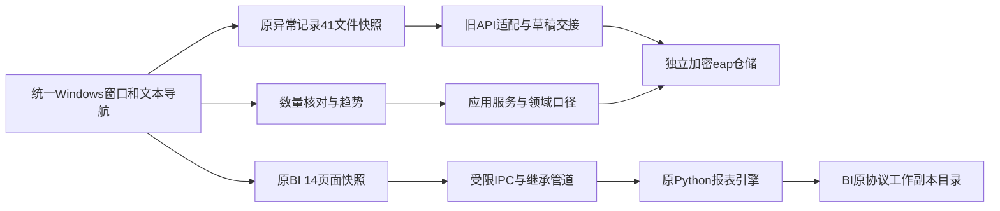

# 0.3 融合结构与设计决策

## 模块边界

- domain/application 不依赖窗口或数据库实现；新增 query-service 统一数据分页、排序与检索。
- encrypted repository 负责串行事务、独占锁、验证、密文原子替换、密码轮换与回滚。原`.qav`与融合`.eap`使用独立格式、AAD和入口，不能就地混写。
- 完整旧状态不压缩成分析字段。legacy/full-state 验证完整JSON并保留未知旧字段；只读分析投影与正式状态分开。同步保存保持原UI的提交前结果语义，和异步导入排队冲突时明确拒绝。
- desktop/legacy-handoff 仅替换构建快照启动交接，保留原业务IIFE；18个旧桌面方法全部由新宿主承接。原41文件不改写。
- desktop/bi-client 只管理进程和请求生命周期；bi-worker.py 只调用白名单原处理器；bi-host.js 管理原生选择、子视图、授权目录和备份。没有本机HTTP服务。
- 锁定/关闭先保存BI配置、等待已有请求，再保存原录入会话，清除页面与密钥。报表生成未完成或保存失败时明确提示并保留窗口，不能静默丢输入。

## 选择复用原引擎的理由

原BI含多套存储、报表公式、历史快照、字段映射和12类图表。先完整适配，成本与业务回归风险低于根据截图重写少数图表。代价是开发候选中保留两种存储协议，BI目录仍明文，备份分别管理。尚未实现跨模块的任意字段关联与统一BI密文存储，界面和说明如实标注。

原BI在源码模式把数据写源码目录，并把数据目录/libs放在模块搜索前端；融合启动先注入显式资源/数据目录并恢复可信模块搜索路径。原网页的任意打开/选路径/退出接口由Electron宿主代替，不对渲染页面暴露任意进程执行。

## UI 规范与依据

设计取自 Apple HIG 的清晰内容层级、侧栏、键盘焦点与减少动画原则，结合Windows原生窗口控制。没有迁移SwiftUI或WinUI，也没有用高透明材料覆盖表格。雾银/浅色玻璃/石墨/高对比是项目选择，不是Apple强制配色。

统一字体、6至8px控件圆角、36px导航行、文本按钮、表头对比和内容滚动。去掉重复标题、宣传区、侧栏装饰图标；数据图表与有意义的状态提示保留。原业务详情和字段标签保留可理解性。

参考：[Apple Sidebars](https://developer.apple.com/design/human-interface-guidelines/sidebars)、[Materials](https://developer.apple.com/design/human-interface-guidelines/materials)、[Accessibility](https://developer.apple.com/design/human-interface-guidelines/accessibility)、[Fluent2](https://fluent2.microsoft.design/)、[Electron WebContentsView](https://www.electronjs.org/docs/latest/api/web-contents-view)。具体布局和令牌是本项目设计建议，实际测试结果另列。

## 代码和版本约束

新增宿主分为UI、会话、传输、原协议适配、领域服务；普通JSON边界拒绝访问器/循环/稀疏数组及过量键值。源码UTF-8/LF，新增桌面JS/CSS/HTML以项目Prettier配置整理。格式化工具只在构建作业中使用，不是程序运行依赖。

成果只有当前/上一原桌面入口；新融合版放当前版本的开发区。版本索引唯一。交付含源码、构建脚本、运行时、继承清单、测试、文件校验和回滚说明；只有公司目标环境验收后才能讨论替换在用版或清理历史。
